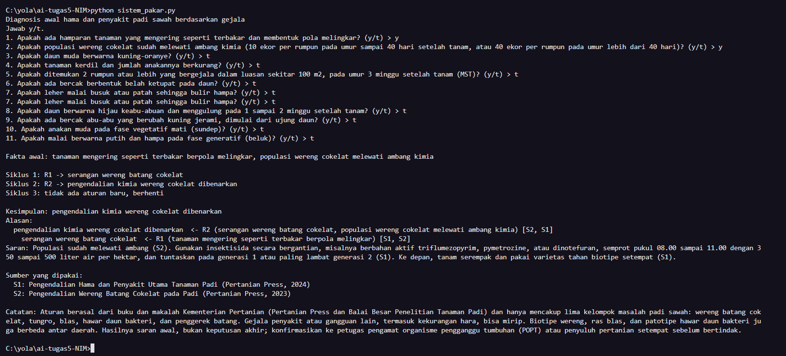
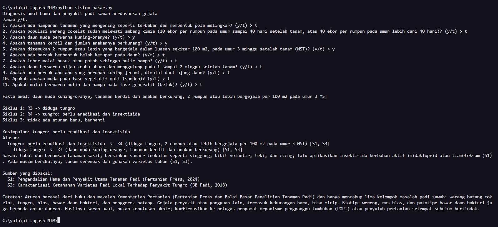
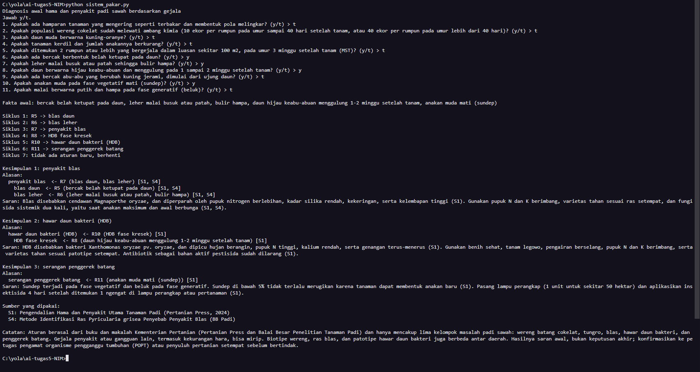
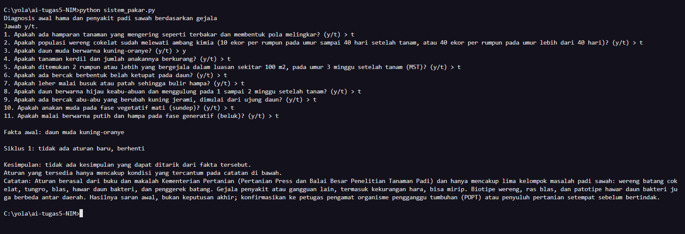

# Tugas 5: Sistem Pakar Sederhana untuk Hama dan Penyakit Padi Sawah

## 1. Identitas

Nama: [BAIQ ERWINA YOLANDA]
NIM: [ F1D02410039 ]

## 2. Topik dan cara menjalankan program

Topik yang saya pilih adalah diagnosis awal hama dan penyakit padi sawah dari gejala yang terlihat di lapangan. Program menanyakan sebelas hal tentang kondisi tanaman, lalu menyimpulkan masalah yang paling mungkin dan memberi saran penanganan awal. Ada lima kelompok masalah yang dicakup: wereng batang cokelat, tungro, blas, hawar daun bakteri (HDB), dan penggerek batang.

Programnya ditulis dengan Python 3 dan tidak butuh pustaka tambahan. Saya mengetesnya dengan Python 3.13, tapi seharusnya jalan juga di Python 3.8 ke atas.

Jalankan dari dalam folder repository:

```
python sistem_pakar.py
```

## 3. Sumber dan aturan

Semua sumber berasal dari Kementerian Pertanian dan balai penelitian di bawahnya, jadi seluruhnya dari Indonesia. Semuanya saya akses pada 9 November 2026.

| Kode | Judul                                                                                                                | Penulis dan penerbit                                                                                                                            | URL                                                                                         |
| ---- | -------------------------------------------------------------------------------------------------------------------- | ----------------------------------------------------------------------------------------------------------------------------------------------- | ------------------------------------------------------------------------------------------- |
| S1   | Pengendalian Hama dan Penyakit Utama Tanaman Padi                                                                    | Suprihanto dkk., Pertanian Press bekerja sama dengan BBPSI Padi (Kementerian Pertanian), 2024                                                   | https://epublikasi.pertanian.go.id/pertanianpress/catalog/download/90/91/751?inline=1       |
| S2   | Pengendalian Wereng Batang Cokelat pada Padi (mengacu pada Buku Teknik Mengendalikan Hama dan Penyakit Tanaman Padi) | Pertanian Press (Kementerian Pertanian), 2023; nama penulis tidak dicantumkan                                                                   | https://repository.pertanian.go.id/bitstreams/d56e8cbf-cf20-42de-9a64-a1666c33c5d9/download |
| S3   | Karakterisasi Ketahanan Varietas Padi Lokal Terhadap Penyakit Tungro                                                 | Dede Kusdiaman dkk., Balai Besar Penelitian Tanaman Padi, Prosiding Padi 2018 Jilid 3                                                           | https://repository.pertanian.go.id/bitstreams/3ac828a9-804b-467a-b4c7-a2813a9dd1a9/download |
| S4   | Metode Identifikasi Ras Pyricularia grisea Sacc. Penyebab Penyakit Blas pada Tanaman Padi                            | Laila Nur Milati, Anggiani Nasution, dan Sudir, Balai Besar Penelitian Tanaman Padi; tahun terbit tidak dicantumkan (penelitian dilakukan 2015) | https://repository.pertanian.go.id/bitstreams/1adeddbb-ba28-4001-b86d-434c73ef984b/download |

S1 jadi sumber utama karena satu buku itu sudah memuat gejala, penyebab, dan pengendalian kelima kelompok masalah. S2 saya pakai untuk ambang pengendalian kimia wereng cokelat, S3 untuk gejala dan prinsip pengendalian tungro, dan S4 untuk gejala blas daun dan blas leher. Dari S3 dan S4 saya hanya mengambil gejala dan prinsip pengendaliannya. Angka luas serangan dan kehilangan hasil tidak saya pakai karena sebagian terlihat tidak konsisten di dokumennya sendiri. Nama serangga penular tungro juga tidak saya masukkan ke aturan, karena penyebutannya di S3 berubah-ubah (wereng hijau di satu bagian, wereng cokelat di bagian lain).

Dari sumber-sumber itu saya menyusun sebelas aturan IF-THEN dalam bentuk parafrasa, bukan kutipan langsung. Hasil R1, R3, R5, R6, R8, dan R9 dipakai lagi oleh aturan lain, jadi ada rantai penalarannya.

| Aturan | IF                                                                                   | THEN                                         | Sumber |
| ------ | ------------------------------------------------------------------------------------ | -------------------------------------------- | ------ |
| R1     | tanaman mengering seperti terbakar berpola melingkar                                 | serangan wereng batang cokelat               | S1, S2 |
| R2     | serangan wereng batang cokelat **AND** populasi wereng cokelat melewati ambang kimia | pengendalian kimia wereng cokelat dibenarkan | S2, S1 |
| R3     | daun muda kuning-oranye **AND** tanaman kerdil dan anakan berkurang                  | diduga tungro                                | S1, S3 |
| R4     | diduga tungro **AND** 2 rumpun atau lebih bergejala per 100 m2 pada umur 3 MST       | tungro: perlu eradikasi dan insektisida      | S1, S3 |
| R5     | bercak belah ketupat pada daun                                                       | blas daun                                    | S1, S4 |
| R6     | leher malai busuk atau patah, bulir hampa                                            | blas leher                                   | S1, S4 |
| R7     | blas daun **OR** blas leher                                                          | penyakit blas                                | S1, S4 |
| R8     | daun hijau keabu-abuan menggulung 1-2 minggu setelah tanam                           | HDB fase kresek                              | S1     |
| R9     | bercak abu-abu lalu kuning jerami dari ujung daun                                    | HDB fase hawar                               | S1     |
| R10    | HDB fase kresek **OR** HDB fase hawar                                                | hawar daun bakteri (HDB)                     | S1     |
| R11    | anakan muda mati (sundep) **OR** malai putih dan hampa (beluk)                       | serangan penggerek batang                    | S1     |

Rantai yang paling jelas ada di R1 ke R2 (wereng cokelat) dan R3 ke R4 (tungro), masing-masing dua tingkat. Selain itu, R5 dan R6 sama-sama mengarah ke R7 (dua gejala berbeda yang menyimpulkan penyakit blas), dan R8 serta R9 mengarah ke R10 (dua fase HDB yang menyimpulkan satu penyakit). Kesimpulan akhir yang bisa keluar ada tujuh: serangan wereng batang cokelat, pengendalian kimia wereng cokelat dibenarkan, diduga tungro, tungro dengan tindakan eradikasi dan insektisida, penyakit blas, hawar daun bakteri, dan serangan penggerek batang.

Ambang pada R2 saya ambil dari S2: insektisida kimia baru dibenarkan kalau setelah pengelolaan agroekosistem masih ditemukan 10 ekor atau lebih per rumpun pada tanaman sampai umur 40 hari setelah tanam, atau 40 ekor atau lebih per rumpun pada tanaman yang lebih tua. Program hanya bertanya apakah ambang itu sudah terlewati, jadi pengguna perlu menghitung populasi wereng di lapangan lebih dulu.

## 4. Metode: forward chaining

Saya memakai forward chaining karena datanya sudah ada di awal, yaitu gejala yang dilihat pengguna di sawah, dan kesimpulan yang mungkin ada banyak tapi biasanya hanya sedikit yang cocok untuk satu petak. Pengguna juga tidak datang dengan satu dugaan yang mau dibuktikan, jadi lebih masuk akal menalar maju dari gejala ke diagnosis daripada mundur dari satu tujuan. Alasan ini sejalan dengan yang dijelaskan di materi kuliah tentang kapan forward chaining dipilih.

Mesin inferensinya dibuat sendiri tanpa pustaka sistem pakar, dan ada di fungsi `forward_chaining`. Langkahnya seperti ini:

```
memori <- fakta yang dijawab "ya" oleh pengguna
ULANGI:
    cocok <- aturan yang syaratnya terpenuhi oleh memori DAN hasilnya belum ada di memori
    JIKA cocok kosong: BERHENTI
    r <- cocok[0]                      # ambil aturan pertama
    tambahkan r.maka ke memori
    catat bahwa r.maka berasal dari r  # bahan "alasan"

syarat terpenuhi: mode "dan" = semua ada di memori, mode "atau" = salah satu ada
```

Aturan yang hasilnya sudah ada di memori tidak dijalankan lagi, kalau tidak programnya akan berputar terus. Pertanyaan ke pengguna diambil otomatis dari fakta yang tidak pernah menjadi hasil aturan mana pun. Kesimpulan akhir adalah hasil aturan yang tidak dipakai sebagai syarat oleh aturan lain yang ikut berjalan. Jadi kalau hanya R1 yang jalan, kesimpulannya "serangan wereng batang cokelat", tapi kalau R2 ikut jalan, kesimpulannya naik menjadi "pengendalian kimia dibenarkan". Alasan ditampilkan dengan menelusuri mundur dari kesimpulan lewat catatan aturan yang menghasilkannya, sampai ke fakta awal.

## 5. Kasus uji dan screenshot

Nomor di kolom jawaban "ya" mengikuti urutan pertanyaan di program (1 sampai 11), dan pertanyaan yang tidak disebut dijawab "tidak". Kasus 4 adalah kasus negatif.

| #   | Jawaban "ya"                                                                                        | Kesimpulan yang diharapkan                                         |
| --- | --------------------------------------------------------------------------------------------------- | ------------------------------------------------------------------ |
| 1   | 1 (tanaman mengering melingkar), 2 (ambang wereng terlewati)                                        | pengendalian kimia wereng cokelat dibenarkan                       |
| 2   | 3 (daun muda kuning-oranye), 4 (kerdil dan anakan berkurang), 5 (2 rumpun per 100 m2 pada 3 MST)    | tungro: perlu eradikasi dan insektisida                            |
| 3   | 6 (bercak belah ketupat), 7 (leher malai patah), 8 (daun menggulung hijau keabu-abuan), 10 (sundep) | penyakit blas, hawar daun bakteri (HDB), serangan penggerek batang |
| 4   | 3 (daun muda kuning-oranye saja)                                                                    | tidak ada kesimpulan                                               |

Kasus 4 menunjukkan bahwa daun kuning-oranye saja belum cukup untuk menyimpulkan tungro, karena R3 juga mensyaratkan tanaman kerdil dan anakan berkurang.

**Kasus 1: rantai dua tingkat pada wereng cokelat (R1 lalu R2)**



**Kasus 2: rantai dua tingkat pada tungro (R3 lalu R4)**



**Kasus 3: tiga kesimpulan sekaligus (R5, R6, R7, R8, R10, R11)**



**Kasus 4: tidak ada kesimpulan (kasus negatif)**



## 6. Batas keberlakuan

Pengetahuan di program ini berasal dari dua publikasi Pertanian Press (Kementerian Pertanian) dan dua makalah Balai Besar Penelitian Tanaman Padi, jadi hanya berlaku untuk padi sawah dan lima kelompok masalah tadi: wereng batang cokelat, tungro, blas, HDB, dan penggerek batang. Gangguan lain, misalnya kekurangan hara, bisa punya gejala yang mirip sehingga program bisa salah menyimpulkan. Biotipe wereng, ras blas, dan patotipe HDB juga berbeda antar daerah, dan saran soal varietas tahan atau bahan aktif insektisida bisa berubah mengikuti aturan dan ketersediaan di lapangan. Hasil program hanya saran awal, bukan keputusan akhir, jadi sebaiknya dikonfirmasi dulu ke petugas pengamat organisme pengganggu tumbuhan (POPT) atau penyuluh pertanian setempat sebelum bertindak di sawah. Catatan yang sama muncul di akhir setiap keluaran program.

## 7. Penggunaan alat bantu AI

Dalam menyelesaikan tugas ini, saya ikut berperan mulai dari menentukan topik dan ruang lingkup pembahasan, memilih gejala yang akan dijadikan dasar sistem, mencari serta mempelajari referensi, hingga menyusun skenario pengujian. Saya juga menjalankan program secara langsung, mengecek hasil proses inferensi, dan mengambil screenshot sebagai bukti pengujian. Selain itu, saya melakukan peninjauan terhadap aturan dan hasil program agar sesuai dengan tujuan tugas.

Dalam proses pengerjaannya, saya memanfaatkan ChatGPT untuk membantu memahami gambaran struktur sistem, memberikan arahan dalam penyusunan kode Python dan basis pengetahuan JSON, serta membantu memperbaiki penulisan dokumentasi dan README. Setiap saran yang diberikan AI saya pelajari dan sesuaikan kembali dengan kebutuhan program, sehingga keputusan akhir dan pemeriksaan hasil tetap saya lakukan sendiri.
